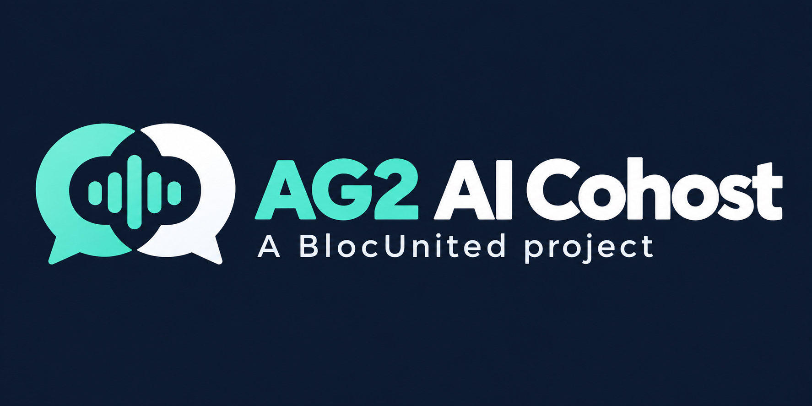
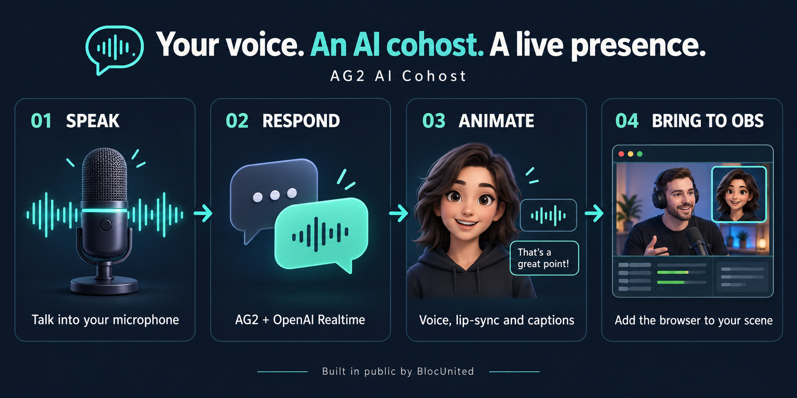

<p align="center">
  
</p>

<h1 align="center">AG2 AI Cohost</h1>

<p align="center">
  <strong>Give your next stream a voice to talk to.</strong><br />
  A real-time AI voice companion with an animated avatar, built in public by
  <a href="https://github.com/BlocUnited-LLC">BlocUnited</a>.
</p>

<p align="center">
  <a href="LICENSE"></a>
  
  <a href="CONTRIBUTING.md"></a>
</p>

<p align="center">
  <a href="#what-you-can-do">Features</a> &middot;
  <a href="#how-it-works">How it works</a> &middot;
  <a href="#quick-start">Quick start</a> &middot;
  <a href="#bring-your-cohost-into-obs">OBS setup</a> &middot;
  <a href="CONTRIBUTING.md">Contribute</a>
</p>

## A cohost for the conversation

Talk into your microphone. Hear an AI response. Watch a 3D avatar speak along with it.

AG2 AI Cohost brings voice conversation, an on-screen personality, and a transparent browser scene together for **livestreams, podcasts, and interactive demos**. Give the cohost a persona, add context about your project, and make it part of your show through an OBS Browser Source.

The app runs locally with a Node.js web server and an AG2 Python backend. Voice responses and web search use OpenAI services, so an internet connection and your own API access are required.

## What you can do

| Capability | What it brings to your show |
| --- | --- |
| **Have a voice conversation** | Speak through your microphone and hear responses from AG2 LiveAgent with OpenAI Realtime. |
| **Give the voice a face** | TalkingHead and HeadAudio animate a 3D avatar with audio-driven lip-sync. |
| **Keep the conversation moving** | Interrupt a response by speaking; press **M** to mute or unmute your microphone while keeping the connection open. |
| **Make it your cohost** | Configure its personality, opening line, voice, and background knowledge about your projects. |
| **Bring it on screen** | Use the transparent browser scene in OBS, with captions and a thinking indicator. |
| **Extend its abilities** | Use the web-search tool or build integrations from the included Python tool functions. |

> **Integration status:** voice, avatar, captions, and web search are implemented. An optional AG2 research helper can work in the background. Chat moderation and stream-control placeholders are not exposed to the model. Newsletter signup is opt-in and requires your endpoint. See [tool configuration and status](docs/configuration.md#tools-and-function-calling).

## How it works

<p align="center">
  
</p>

The **control page** in Chrome or Edge captures your microphone and controls one shared **AG2 LiveAgent** conversation. The **overlay page** receives its audio, avatar animation, and captions in OBS. Reloading or switching an OBS source does not create another AI conversation. Only clicking **Start cohost** opens the provider connection.

**Current transport:** 24 kHz PCM audio over an authenticated WebSocket at `/session`. AG2 is pinned to **1.2.1**. The Python directory retains the legacy name `realtime_over_webrtc/`; the transport uses WebSockets. API credentials stay in the Python backend. Both services bind to loopback by default.

**Stack:** Node.js / Express · Python / FastAPI · AG2 LiveAgent · OpenAI Realtime · TalkingHead / HeadAudio · Three.js

## Quick start

### 1. Get the prerequisites

- **Node.js 22+**, **Python 3.10+**, and **Git**. CI uses Python 3.13.
- **Chrome or Edge**, a microphone, and headphones for clearer interruptions.
- An **OpenAI API key** with access to the model configured in the [sample configuration](ag2-backend/OAI_CONFIG_LIST_sample). The sample uses `gpt-realtime-2` for voice and `gpt-5-mini` for web search; provider usage is billed to your account.
- **OBS Studio** if you want to add the cohost to a broadcast.

### 2. Clone and install

```bash
git clone https://github.com/BlocUnited-LLC/ag2-ai-cohost.git
cd ag2-ai-cohost
npm install
npm run setup
```

The setup script prepares the included Python backend, creates its local virtual environment, installs dependencies, and creates `ag2-backend/OAI_CONFIG_LIST` from the sample if it does not exist.

### 3. Configure the voice

Open `ag2-backend/OAI_CONFIG_LIST` and replace `<your OpenAI API key here>` with your key. Keep the rest of the sample settings to start, or adjust `voice` and `agent_prompt` to shape your cohost.

This local configuration file is ignored by Git. Keep credentials out of screenshots, issues, and commits. See the [configuration guide](docs/configuration.md) for persona, contacts, and tool settings.

### 4. Start both services

Run these commands from the repository root in **two separate terminals**.

**Terminal 1 — AI backend** (port 5050):

```bash
npm run start:ag2
```

**Terminal 2 — web server** (port 3001):

```bash
npm start
```

Open **[http://localhost:3001/control](http://localhost:3001/control)** in Chrome or Edge, choose your microphone, and click **Start cohost**. Allow microphone access and start talking. Press **M** to mute or unmute and **Escape** to interrupt. Enable **Monitor audio in this browser** for a browser-only conversation; leave it off when OBS handles the sound.

Having trouble with audio or the avatar? Start with [troubleshooting](docs/troubleshooting.md).

## Bring your cohost into OBS

1. Keep both services running and open the control page in Chrome or Edge. Click **Copy overlay URL**; leave **Monitor audio in this browser** off when OBS handles the sound.
2. In OBS, choose your existing **Scene Collection** and the scene where the cohost belongs. In **Sources**, click **+ → Browser**, create a source named **AG2 Cohost**, and paste the full URL, including its `#token=…` fragment.
3. Set the Browser Source to **1280 × 720** and enable **Control audio via OBS**.
4. Move **AG2 Cohost** above backgrounds and display/game captures in the Sources list. Scale and position it in the preview beside your camera or content, keeping captions and alerts readable. Click its padlock once placed.
5. Click **Start cohost** on the control page. Check the avatar, captions, and OBS audio meter. OBS receives the overlay; microphone capture stays in Chrome or Edge.
6. For another scene in the same collection, use **+ → Browser → Add Existing → AG2 Cohost**. Position it independently in that scene. A different collection needs its own Browser Source with the same current overlay URL.

The background is transparent. Keep one audible overlay per active scene and check the OBS monitoring/output route before going live. The private overlay link changes when the backend restarts; copy the new one into each collection that uses it. See [existing-scene setup and audio routing](docs/usage.md#obs-browser-source) for details.

**CaptainCode example:** in the **CaptnCode** collection's **Main Screen** scene, **AG2 Cohost** sits at the top of Sources and is locked in the lower-left corner. Its 1280 × 720 viewport is displayed at **800 × 450**, positioned at **X 24, Y 606** on a 1920 × 1080 canvas, clear of the top banner and lower-right webcam frame. See the [exact layout and audio settings](docs/usage.md#captaincode-layout-example) to reproduce it.

### Run it next time in CaptainCode

The OBS scene setup is saved. Each time you want to use the cohost:

1. Open two terminals in the `ag2-ai-cohost` repository folder.
2. In the first terminal, start the AI backend:

   ```bash
   npm run start:ag2
   ```

3. In the second terminal, start the web app:

   ```bash
   npm start
   ```

4. Open [http://localhost:3001/control](http://localhost:3001/control) in Chrome or Edge. Wait until it says **Ready when you are**.
5. In OBS, open **CaptnCode → Main Screen**. If the avatar is missing after restarting the backend, click **Copy overlay URL** on the control page, open **AG2 Cohost → Properties** in OBS, replace the old URL, and click **OK**. The complete `#token=…` fragment must be included.
6. Confirm the control page says **1 overlay connected** and the avatar appears in the lower-left corner. Choose your microphone and keep **Monitor audio in this browser** off when OBS handles the audio.
7. Click **Start cohost**. Allow microphone access if the browser asks. Speak normally and verify that the avatar moves, captions appear, and the **AG2 Cohost** meter moves in OBS.
8. Use **M** to mute, **Escape** to interrupt a response, and **Stop cohost** when finished.
9. After stopping the cohost, close the control page and press **Ctrl+C** once in each terminal to shut down both local services. The OBS source and its position remain saved.

Starting the services or opening the pages does not begin a paid AI session. The provider connection starts only when you click **Start cohost**.

## Tests

After setup, run `npx playwright install chromium` once, then `npm test`. Backend tests and Playwright browser tests use a simulated provider with the real LiveAgent event path; they do not read your API key or make paid calls. CI runs the same checks. A real OBS Browser Source and a live provider conversation remain separate acceptance checks.

## Make it your own

| Customize | Start here |
| --- | --- |
| Personality, voice, opening line, and project context | [Agent configuration](docs/configuration.md#agent-prompt-and-contacts) |
| Microphone controls and interruption sensitivity | [Browser controls](docs/usage.md#browser-controls) |
| Avatar model and framing | [Avatar renderer](public/js/avatar.js) and [bundled assets](public/assets/) |
| Captions, indicators, and scene styling | [Browser styles](public/css/styles.css) |
| New tools and platform integrations | [Tool configuration](docs/configuration.md#tools-and-function-calling) and [Python tools](ag2-backend/tools/) |

## Build with BlocUnited

AG2 AI Cohost is a **public BlocUnited project**, and contributions are welcome from developers, streamers, designers, and technical writers. A useful bug report, a clearer setup step, or a tested OBS configuration can help just as much as code.

Good places to contribute:

- **Creator experience:** improve onboarding, captions, microphone controls, and OBS setup guidance.
- **Audio reliability:** investigate reconnects, interruption handling, and lip-sync across devices.
- **Platform integrations:** connect the existing tool placeholders to real streaming APIs.
- **Developer experience:** add focused tests and make setup easier to reproduce.
- **Visuals and examples:** share avatar setups, scene layouts, and reusable personas with clear asset permissions.

Read [CONTRIBUTING.md](CONTRIBUTING.md), [report a bug or suggest an idea](https://github.com/BlocUnited-LLC/ag2-ai-cohost/issues/new/choose), or [browse open issues](https://github.com/BlocUnited-LLC/ag2-ai-cohost/issues). For a larger change, open an issue first to discuss its scope.

## Documentation and source

| Resource | What you will find |
| --- | --- |
| [Usage guide](docs/usage.md) | Browser controls, interruptions, and OBS setup |
| [Configuration guide](docs/configuration.md) | Persona, contacts, web search, and integration status |
| [Troubleshooting](docs/troubleshooting.md) | Audio, avatar, connection, and port issues |
| [Contribution guide](CONTRIBUTING.md) | Contribution workflow and useful validation checks |
| [Browser app](public/) | Avatar rendering, audio bridge, and scene UI |
| [Web server](server.js) | Static files and the `/session` WebSocket proxy |
| [Python backend](ag2-backend/realtime_over_webrtc/main.py) | LiveAgent sessions, configuration, and tool registration |
| [Brand assets](docs/assets/) | Project logo, workflow infographic, and generation prompts |

## Credits and license

Built by [BlocUnited](https://github.com/BlocUnited-LLC) with [AG2](https://github.com/ag2ai/ag2), [TalkingHead](https://github.com/met4citizen/TalkingHead), [HeadAudio](https://github.com/met4citizen/HeadAudio), and [Three.js](https://github.com/mrdoob/three.js).

The project includes an [MIT license](LICENSE); the bundled backend includes its own [Apache 2.0 license](ag2-backend/LICENSE). Third-party libraries and avatar assets retain their own terms and notices. The bundled `julia.glb` identifies Ready Player Me in its asset metadata.
